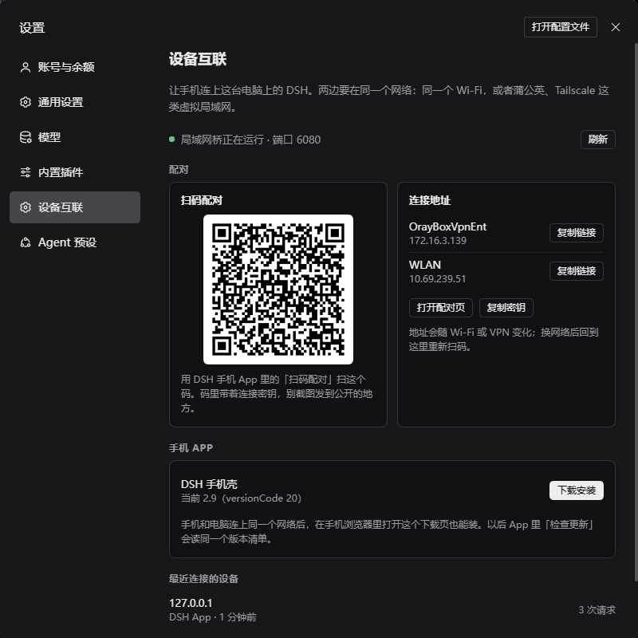

# dsh-mobile-bridge

Mobile bridge for DeepSeek Harness: reach the DSH GUI running on your computer from a phone on the same LAN (or a virtual LAN such as OrayBox/Tailscale), together with the pairing page, the APK download page and the turn-end notification stream.

Split out of the `aurora-boot` theme bundle so the bridge can be installed and distributed on its own.

## What it does

The desktop DSH GUI listens on `127.0.0.1` only, and every document request carries a one-time launch token, so another device cannot open it. This plugin opens a second listener on the LAN (6080 by default, then 6081/6090/7090):

- proxies requests back to the loopback GUI and keeps the upstream cookie server-side
- mints a long-lived bridge cookie from a one-time `?k=<key>` query parameter
- serves a pairing page with QR codes (`dshharness://pair?u=<url>`)
- exposes a directory picker for phones (the native desktop dialog cannot open in a WebView)
- serves the APK download page and version manifest so the phone shell can check for updates
- publishes turn-end events the phone shell polls for system notifications

## Device connections, inside Settings

Once installed, DSH settings gains a **设备互联 (Device connections)** page (account menu at the sidebar foot → Settings, or `Ctrl+,`):

- bridge status and port
- the pairing QR code, ready for the phone app
- every network interface with a one-click copy of the key link
- the phone app download entry and its current version
- recently connected clients: address, device kind, last activity



The device list only records clients that went through the bridge, so you can tell who is using it; real per-device revocation still means rotating the key (delete the key file and restart DSH).

## Easiest install

Works right after installation: no launch flags, no configuration.

1. In DSH open **Plugins → Discover → Index sources** and add:

   ```
   https://cdn.jsdelivr.net/gh/Kattentions/dsh-katt-browser@main/index.json
   ```

   The source includes this bridge (and the sidebar browser); press Install.
2. Restart DSH.
3. Ask the agent to open a page. If the right sidebar was never opened, the first action expands it automatically.

Command line equivalent (no git):

```sh
dsh plugin --profile desktop add https://cdn.jsdelivr.net/gh/Kattentions/dsh-katt-browser@main/dist/dsh-mobile-bridge-latest.tgz
```

## Install

```sh
# npm (once published)
dsh plugin --profile desktop add dsh-mobile-bridge

# release tarball, no git required
dsh plugin --profile desktop add https://github.com/Kattentions/dsh-mobile-bridge/releases/download/v0.2.0/dsh-mobile-bridge-0.2.0.tgz
```

Restart DSH, then open the pairing page:

```
http://127.0.0.1:<gui-port>/__ink/pair
```

On Windows, `open-pair.cmd` reads the GUI address from `~/.dsh/mobile-bridge.json`.

## Pairing and security

- The bridge is meant for a trusted LAN / virtual LAN; **never expose the port to the public internet**
- The key lives in `~/.dsh/mobile-bridge.key` and survives restarts; rotating it invalidates every paired device
- The bridge cookie is long-lived; delete the key file and restart DSH to revoke all devices
- `~/.dsh/mobile-bridge.json` records the current port, addresses and key for the pairing page and the phone app

## Routes

| Path | Purpose |
|---|---|
| `/__ink/ping` | liveness probe, returns `pong` |
| `/__ink/pair` | pairing page with QR codes |
| `/__ink/pair/state` | pairing state as JSON |
| `/__ink/pair/qr?d=<text>` | QR code as SVG |
| `/__ink/fs?path=` | directory listing for the phone picker |
| `/__ink/app` | APK download page |
| `/__ink/app/version.json` | version manifest |
| `/__ink/app/dsh-harness.apk` | the APK |
| `/__ink/notify`, `/last`, `/state`, `/test` | turn-end event stream and diagnostics |
| `/__ink/notify/focus` | GUI reports window focus, so the desktop toast can stay quiet while you are using the app |

## Notifications

Every root session turn end (or error) publishes an event on `/__ink/notify` with the
`sessionId`, its title and its workspace `cwd`. Child sessions, subagents and teammates are
filtered out, so the phone is not woken up by delegated work.

- **Phone**: the app polls `/__ink/notify/last` in the background and shows a system
  notification. Version 3.1 (versionCode 22) renders the body as `workspace folder · session
  title`, which is what you need when several workspaces run at once.
- **Desktop**: a Windows toast is fired only while the app window is *not* focused — the GUI
  posts `{focused:true|false}` to `/__ink/notify/focus` on focus/blur, so you do not get a
  banner for a turn you just watched finish.
- `/__ink/notify/state` exposes the stream count, poll count and the current `uiFocused`
  flag for debugging.

## Relation to the phone shell

The companion Android shell (`dsh-harness`, source in the DSH workspace under `_android`) is what the APK in `public/app` is built from: QR pairing, full-screen WebView, file upload/download, background turn-end notifications
(3.1 adds the workspace folder to the body) and update checks.

## Development check

`npm run check` compares the `/__ink/...` paths the phone shell references against the routes the host registers; a rename on either side fails the check instead of waiting for a dead feature on a real phone.

## Known limits

- Proxy only, no tunnel: for public access use Cloudflare Quick Tunnel / Tailscale / OrayBox and judge the risk yourself
- One key for every device; per-device revocation is not implemented yet
- The APK route reads `public/app` inside the plugin directory and returns 404 when it is missing
