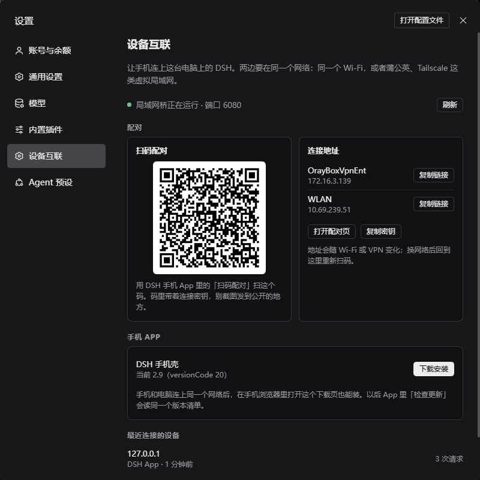

# dsh-mobile-bridge

DeepSeek Harness 手机桥：让同一局域网（或蒲公英/Tailscale 这类虚拟局域网）里的手机访问电脑上的 DSH 界面，顺带托管配对页、APK 下载和「这一轮结束了」通知流。

从 `aurora-boot` 主题插件里拆出来的独立插件，只做桥，不带皮肤。

## 它做什么

桌面版的 DSH GUI 只监听 `127.0.0.1`，而且每个文档请求都带一次性 launch token，别的设备根本打不开。这个插件在局域网另开一个端口（默认 6080，被占用就依次试 6081/6090/7090）：

- 把请求代理回 `127.0.0.1` 的 GUI，Cookie 留在电脑侧
- 用一次性 `?k=<key>` 换长期 Cookie，之后手机不用带 token
- 提供 `dshharness://pair?u=<url>` 二维码配对页
- 给手机用的目录选择接口（桌面弹窗在 WebView 里打不开）
- APK 下载页和版本清单，手机 App 可据此检查更新
- 完成事件通知流，手机壳轮询后弹系统通知

## 设置里的「设备互联」

装好后 DSH 设置里会多一页**设备互联**（左下角账号菜单 → 设置，或 `Ctrl+,`）：

- 桥的运行状态和端口
- 配对二维码，手机 App 直接扫
- 每个网络接口的连接地址，一键复制带密钥的链接
- 手机 App 下载入口和当前版本
- 最近连接过的设备：IP、设备类型、最后活动时间



设备列表只记录通过桥访问过的客户端，用来确认「到底是谁在用」；真正撤销某台设备目前还是整把换 key（删掉 key 文件重启 DSH）。

## 最省事的安装

装完就能用：不用加启动参数，不用改配置。

1. DSH 里打开 **插件 → 发现 → 索引源**，加上这个地址：

   ```
   https://cdn.jsdelivr.net/gh/Kattentions/dsh-katt-browser@main/index.json
   ```

   这个源里包含手机桥（和侧栏浏览器），点「安装」即可。
2. 装完重启 DSH。
3. 直接让 agent 打开网页即可；右侧栏没开、甚至没打开过浏览器标签页，第一次操作会自动展开。

命令行等价（不需要 git）：

```sh
dsh plugin --profile desktop add https://cdn.jsdelivr.net/gh/Kattentions/dsh-katt-browser@main/dist/dsh-mobile-bridge-latest.tgz
```

## 安装

```sh
# npm（发布后）
dsh plugin --profile desktop add dsh-mobile-bridge

# Release 压缩包，不需要 git
dsh plugin --profile desktop add https://github.com/Kattentions/dsh-mobile-bridge/releases/download/v0.2.0/dsh-mobile-bridge-0.2.0.tgz
```

装完重启 DSH，然后打开配对页：

```
http://127.0.0.1:<GUI端口>/__ink/pair
```

Windows 上可以用仓库里的 `open-pair.cmd`（从 `~/.dsh/mobile-bridge.json` 读 GUI 地址）。

## 配对与安全

- 桥只对局域网/虚拟局域网开放，**不要把这个端口映射到公网**
- key 存在 `~/.dsh/mobile-bridge.key`，重启复用，换 key 等于让所有已配对设备失效
- Cookie 是长期有效的；换网络或怀疑泄露时，删掉 key 文件再重启 DSH 即可全部作废
- 状态文件 `~/.dsh/mobile-bridge.json` 记录当前端口、地址和 key，供配对页和手机 App 读取

## 接口

| 路径 | 用途 |
|---|---|
| `/__ink/ping` | 存活探测，返回 `pong` |
| `/__ink/pair` | 配对页（二维码） |
| `/__ink/pair/state` | 配对信息 JSON |
| `/__ink/pair/qr?d=<text>` | 二维码 SVG |
| `/__ink/fs?path=` | 手机端目录选择列表 |
| `/__ink/app` | APK 下载页 |
| `/__ink/app/version.json` | 版本清单 |
| `/__ink/app/dsh-harness.apk` | 安装包 |
| `/__ink/notify`、`/last`、`/state`、`/test` | 完成事件流与诊断 |
| `/__ink/notify/focus` | GUI 上报窗口焦点，用着 DSH 的时候桌面 toast 不打扰 |

## 通知

每个**根会话**的 turn end（或出错）会往 `/__ink/notify` 推一条事件，带 `sessionId`、会话标题和工作区路径 `cwd`。子会话、子智能体、团队成员的工作会结束，但不会推给你的手机。

- **手机**：App 后台轮询 `/__ink/notify/last` 并弹系统通知。3.1（versionCode 22）起通知正文是「工作区文件夹 · 会话标题」，多工作区同时跑的时候能看出是哪一条。
- **桌面**：只有 DSH 窗口**不在前台**时才弹 Windows toast——GUI 会在 focus/blur 时向 `/__ink/notify/focus` 上报状态，你正看着屏幕时不会再收到「这一轮结束了」的横幅。
- `/__ink/notify/state` 会给出流数量、轮询次数和当前的 `uiFocused`，排查通知问题时看这个。

## 和手机壳的关系

配套 Android 壳（`dsh-harness`，源码在 DSH 工作区的 `_android`）就是本仓库 `public/app` 里那份 APK 的源码产物：扫码配对、WebView 全屏、文件上传下载、后台完成通知（3.1 起正文带工作区文件夹）、更新检查。

## 开发自检

`npm run probe:devices` 是需要在运行中执行的真机隔离探针：临时配对两台设备，验证撤销一台不影响另一台、被撤销的令牌立即 401，结束后自动撤销自己创建的设备并清空手机队列（不会碰你真实配对的手机）。

`npm run check` 做两件事：对照手机壳源码里引用的 `/__ink/...` 路径和宿主实际注册的路由；核对 `public/app/version.json` 与 `dsh-harness.apk` 的版本和字节数是否一致（不一致会让手机的「检查更新」拿错文件），任何一边改了名字都会直接报出来——这类断裂以前只有真机上才会发现。

## 已知边界

- 只代理，不做隧道；公网访问请用 Cloudflare Quick Tunnel / Tailscale / 蒲公英，并自行评估风险
- 一把 key 对应所有设备，暂不支持按设备单独撤销
- APK 下载路由读的是插件目录下的 `public/app`，没有文件时返回 404
